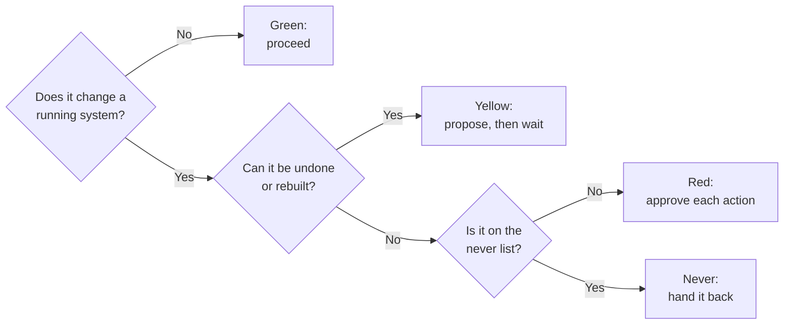

# Green, yellow, red: who may change what

Running a server means making changes to it, and some changes are much
harder to undo than others. Reading a log file is harmless. Restarting a
game server interrupts whoever is playing. Deleting a virtual machine can
erase a world that took months to build.

This lab uses a simple traffic-light policy to sort every action by how hard
it is to reverse. The policy was written for AI coding assistants that help
maintain the lab, but the same rules apply to a person working late, a script
someone wrote a year ago, and a runbook being followed step by step. The
question is always the same: **how much damage can this do, and who has to say
yes before it runs?**

## The four levels

Each action gets one of four levels. The colors are only a visual cue; the
level names carry the meaning.

| Level | What it covers | What happens before it runs |
| --- | --- | --- |
| Green | Reading, previewing, and editing files in the project repository | Nothing. Go ahead. |
| Yellow | A reversible or reproducible change to a running system | Say what will change, where, and how to undo it. Wait for a clear yes. |
| Red | Anything that destroys something: a machine, a disk, a backup, a snapshot | Say what will be lost, whether a backup exists, and whether it can be recovered. Get a separate yes immediately before each action. |
| Never | Changes that no approval unlocks | Stop and hand the task back to the person in charge. |

### Green: proceed without asking

Green actions cannot break a running service. Reading configuration, checking
disk space, looking at history, and running a preview that reports what a
tool *would* do are all green. So is editing files inside the project
repository, because a saved file changes nothing until someone applies it.

Previews matter here. Tools such as OpenTofu and Ansible can show the exact
changes they would make without making them. Producing that preview is green,
and it is how yellow work gets proposed: the preview is the proposal.

### Yellow: propose, then act on approval

Yellow actions change something that is running, but the change can be
reversed or rebuilt from written definitions. Creating a virtual machine,
restarting an application, installing a package, or applying a reviewed
configuration change all fall here.

The rule is to describe the change first: what will change, on which machine,
and how to undo it. Then wait for an explicit yes. A runbook that explains
how to do something does not count as that yes; it explains the steps, and
the approval is a separate decision.

### Red: destructive, one approval per action

Red does not mean forbidden. It means the action destroys something, so it
needs its own approval, every time, immediately before it runs. Deleting a
virtual machine, removing a disk, dropping a backup, formatting a drive, and
rebooting the physical host are all red.

Before asking, the request has to state three things: what will be destroyed,
whether a backup of it exists, and whether it is recoverable. If a
tool's preview shows that something will be destroyed or replaced, those
lines get called out on their own. Approval to "apply the change" is not
approval to destroy what the change would remove.

### Never: no approval unlocks these

A few changes stay off the table entirely, because getting them wrong could
cut off remote access to a computer that lives in a closet. Changes to the
home router or to the network that manages the physical host are examples,
along with committing a secret into a repository. If a task seems to need one
of these, the right move is to stop and hand the task back.

## Rules that keep the levels honest

The levels only work if approval means something. A few rules protect that.

- **Approval is single-use.** Saying yes to one restart does not cover the
  next one, even if it looks identical. The person in charge can grant a
  narrow pre-approval for a session, but it covers only the yellow actions
  they actually named and expires when the session ends.
- **Nothing escalates.** No conversation turns a never item into a red one.
- **No batching.** A yellow or red step cannot be tucked into a script or
  playbook that was approved for something else. Each one is named and
  approved on its own.
- **Uncertainty resolves upward.** If an action does not clearly fit a level,
  it is at least yellow. Guessing green is the one mistake the policy is
  designed to prevent.
- **A preview is not an apply.** The words used to describe an action are
  chosen carefully so that "planned", "applied", and "verified" never blur
  into each other.

## Words that keep the record honest

The levels decide who says yes. A second habit decides what gets written
down afterward, because a record that overstates progress is how the next
person gets surprised. The lab uses a few state words precisely:

| Word | What it means |
| --- | --- |
| Planned | Written down and reviewed. Nothing has changed yet. |
| Applied | The change was made. It may or may not work. |
| Partially applied | Some of it was made. The rest is named. |
| Verified | Something was checked directly, with a date, and the check is recorded. |
| Blocked | It cannot proceed, and the reason is written down. |

A preview is not an apply. An installed package is not a configured service.
A definition committed to Git is not a running machine. Milestones stay open
until every "done when" condition has evidence, and the same care goes into
recording failed, partial, and reverted work as successful work.

Two more rules protect the record. A finding, gap, or risk gets a permanent
identifier and is resolved by moving its entry, never by deleting it. And
every restore test is logged with its date, how long it took, and what went
wrong, so "the backup works" always points at a specific occasion.

## Working while the operator is away

Sometimes the useful work is a list of yellow and red steps, and the person
who has to approve them would rather not sit through each one. The policy
allows a written, numbered plan for that case. Each entry names the action,
its level, the machine it touches, the recovery position, how to undo it, and
what would halt it. The operator approves entries by number, in writing.

The plan is then the entire authorization. Anything not on it is not
approved, even if it turns out to be needed to finish an approved entry.
Entries run in order, the whole run halts on the first surprise, and each
red entry's backup is re-checked right before it runs. A halted run that
reports honestly is the plan working as intended.

## Why bother with this in a home lab

The lab is designed to be rebuildable, and the [backup and recovery
drills](projects.md#game-hosting-and-recovery) exist so that a destroyed
machine is an inconvenience rather than a loss. The permission levels are
the other half of that design. They make the destructive step the slow,
deliberate one, and they give an assistant a clear way to be useful without
being trusted with everything at once.

The policy also shapes how work is described. Because a red request must
name what a backup covers, gaps in the backups get noticed before they
matter. Because yellow requests must explain the undo, the undo tends to get
written down.

## Applying it to your own setup

You do not need an AI assistant to use this. Write down your own never list
first, since those are the changes you most regret. Then sort the rest by one
question: if this goes wrong, can I get back to where I was? If yes, it is
yellow. If no, it is red, and the thing that makes it survivable is a backup
you have actually restored from.

[Back to the homelab overview](../README.md) |
[See the architecture overview](architecture.md) |
[Why the lab is built this way](decisions.md) |
[Read the lessons](what-i-learned.md)
